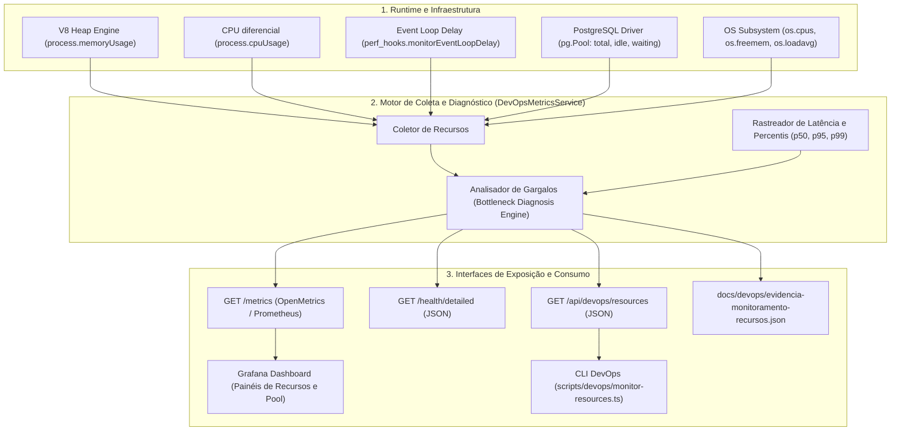

# PADRONIZAÇÃO DE DEVOPS: MONITORAMENTO DE RECURSOS E DESEMPENHO DA APLICAÇÃO

**Projeto:** Sistema de Estações Meteorológicas IoT — Cenário 01 (Agritech)  
**Instituição / Parceiro:** Fatec São José dos Campos / Tecsus — Tecnologias para a Sustentabilidade  
**Curso / Semestre:** 4º DSM — Semestre 2026-2  
**Frente:** Engenharia de DevOps, Observabilidade e Confiabilidade (SRE)  
**História de Usuário:** US06 — Disponibilidade e Escalabilidade do Sistema  
**Atividade:** [DEVOPS] Configurar monitoramento de recursos e desempenho da aplicação (SCRUM-471)

---

## 1. OBJETIVO E ESCOPO

Este documento formaliza a arquitetura, especificação técnica de telemetria, limiares analíticos e rotinas operacionais para o **monitoramento contínuo de recursos computacionais e métricas de desempenho** da plataforma **AgriTech (Vulture)**, provendo visibilidade detalhada sobre o consumo de infraestrutura e identificação proativa de potenciais gargalos antes que afetem o Acordo de Nível de Serviço (SLA $\ge 99.0\%$).

### 1.1. Escopo Atendido

1. **Telemetria de Recursos Computacionais:** Coleta em tempo real de métricas de processo e sistema operacional: Memória Heap do Node.js (V8), RSS, uso de CPU da aplicação, latência do Event Loop e conexões do pool do PostgreSQL.
2. **Métricas de Desempenho e Vazão:** Taxa de requisições por segundo (throughput), percentis de latência HTTP ($p50$, $p95$, $p99$, média) e tempo de resposta de queries no banco de dados.
3. **Mecanismo de Diagnóstico de Gargalos (Bottleneck Detection):** Regras determinísticas com limiares de alerta (_Warning_) e criticidade (_Critical_) para identificação automática de contenção de CPU, saturação de memória, travamento do Event Loop e esgotamento do pool de dados.
4. **Disponibilização para o Time de Engenharia:** Endpoints JSON REST dedicados (`GET /api/devops/resources`, `GET /health/detailed`), exportação de métricas OpenMetrics para Prometheus (`GET /metrics`), interface CLI em tempo real e painéis no Grafana.
5. **Automação e Evidência Auditável:** Scripts de teste de estresse/carga e exportação de relatórios auditáveis em formato padronizado JSON (`evidencia-monitoramento-recursos.json`).

### 1.2. Matriz de Critérios de Aceite

| Critério de Aceite                                 |     Status      | Implementação e Evidência                                                                                                                                                                      |
| :------------------------------------------------- | :-------------: | :--------------------------------------------------------------------------------------------------------------------------------------------------------------------------------------------- |
| **CA1. Recursos definidos são monitorados**        | ✅ **Atendido** | Coleta contínua de V8 Heap (usado, total, percentual), RSS, CPU do processo (diferencial de microssegundos), Lag do Event Loop via `monitorEventLoopDelay` e conexões do PostgreSQL Pool.      |
| **CA2. Métricas de desempenho são coletadas**      | ✅ **Atendido** | Agregação em memória de latência por rota e global ($p50, p95, p99$), throughput por código de status HTTP (2xx, 4xx, 5xx) e ping SQL do PostgreSQL.                                           |
| **CA3. Informações ficam disponíveis para o time** | ✅ **Atendido** | Endpoint REST `/api/devops/resources`, `/health/detailed`, métricas em `/metrics` para Prometheus, painéis no Grafana e CLI `scripts/devops/monitor-resources.ts`.                             |
| **CA4. Dados permitem identificar gargalos**       | ✅ **Atendido** | Motor de diagnóstico no `DevOpsMetricsService` que confronta métricas com limiares e emite diagnósticos estruturados com tipo, severidade, valor atual, threshold e recomendação de mitigação. |

---

## 2. ARQUITETURA DE TELEMETRIA E OBSERVABILIDADE

A solução é implementada dentro do núcleo do monolito modular (`API-DSM-4-BACKEND`), operando sem bibliotecas externas pesadas e com impacto negligenciável sobre o event loop:



---

## 3. ESPECIFICAÇÃO DE RECURSOS E MÉTRICAS MONITORADAS

### 3.1. Memória do Processo (V8 & Sistema)

- **`heapUsedMb` / `heapTotalMb`:** Memória alocada e utilizada pelo garbage collector da V8 para objetos, buffers e closures.
- **`heapUsagePercent`:** Razão percentual $\frac{\text{heapUsed}}{\text{heapTotal}} \times 100$.
- **`rssMb` (Resident Set Size):** Quantidade total de memória RAM do sistema operacional ocupada pelo processo Node.js (inclui V8 heap, C++ bindings e código carregado).
- **`externalMb`:** Memória utilizada por objetos C++ gerenciados pela V8 (como Buffers do Node.js).

### 3.2. Uso de CPU da Aplicação

- **Medição Diferencial Precisa:** O consumo percentual de CPU é calculado por amostragem entre dois ciclos temporais consecutivos:
  $$\Delta\text{cpuTime} = (\Delta\text{user} + \Delta\text{system}) \quad [\mu\text{s}]$$
  $$\Delta\text{elapsedTime} = (\text{timestamp}_{\text{atual}} - \text{timestamp}_{\text{anterior}}) \times 1000 \times N_{\text{cores}} \quad [\mu\text{s}]$$
  $$\text{CPU Percent} = \min\left(100.0, \frac{\Delta\text{cpuTime}}{\Delta\text{elapsedTime}} \times 100\right)$$

### 3.3. Atraso do Event Loop (Event Loop Delay)

- Amostrado com resolução de $20\text{ ms}$ utilizando a API nativa `monitorEventLoopDelay` do Node.js (`node:perf_hooks`).
- Registra o atraso (lag) real enfrentado pela fila de microtarefas e eventos assíncronos. Atrasos excessivos indicam operações síncronas bloqueantes na thread principal.

### 3.4. Pool de Conexões do Banco de Dados (PostgreSQL)

- **`totalConnections`:** Total de conexões abertas no pool `pg.Pool`.
- **`activeConnections`:** Conexões atualmente executando transações ou consultas SQL.
- **`idleConnections`:** Conexões abertas disponíveis para reutilização imediata.
- **`waitingClients`:** Requisições enfileiradas aguardando a liberação de uma conexão livre. Valores maiores que zero indicam saturação do pool.

---

## 4. MOTOR DE DIAGNÓSTICO DE GARGALOS (BOTTLENECK DETECTION)

O sistema conta com um motor de avaliação contínua que classifica anomalias em níveis `WARNING` e `CRITICAL`, gerando recomendações imediatas de mitigação:

| Tipo de Gargalo          | Severidade |         Limiar de Gatilho         | Condição Técnica                      | Recomendação de Mitigação                                                             |
| :----------------------- | :--------: | :-------------------------------: | :------------------------------------ | :------------------------------------------------------------------------------------ |
| **`HIGH_MEMORY`**        | `WARNING`  |           $\ge 85.0\%$            | Consumo de Heap V8 elevado            | Monitorar vazamentos pontuais de memória em coleções e caches locais.                 |
| **`HIGH_MEMORY`**        | `CRITICAL` | $\ge 92.0\%$ ou $> 500\text{ MB}$ | Memória próxima do esgotamento        | Investigar retenção de referências ou listeners; aumentar `--max-old-space-size`.     |
| **`CPU_SATURATION`**     | `WARNING`  |           $\ge 80.0\%$            | Consumo sustentado de CPU             | Identificar loops intensivos, parsing de grandes payloads síncronos.                  |
| **`CPU_SATURATION`**     | `CRITICAL` |           $\ge 90.0\%$            | Saturação crítica de CPU              | Otimizar rotinas computacionais ou escalar horizontalmente instâncias.                |
| **`EVENT_LOOP_BLOCKED`** | `WARNING`  |       $\ge 50.0\text{ ms}$        | Lag moderado no Event Loop            | Evitar operações síncronas (`fs.*Sync`, `crypto` síncrono); delegar a Worker Threads. |
| **`EVENT_LOOP_BLOCKED`** | `CRITICAL` |       $\ge 200.0\text{ ms}$       | Bloqueio severo da thread única       | Eliminar parsing de grandes arquivos JSON em runtime e regex catastróficas.           |
| **`DB_POOL_SATURATION`** | `WARNING`  |        $\ge 80\%$ conexões        | Pool com pouca folga                  | Avaliar fechamento de transações e pools dedicados.                                   |
| **`DB_POOL_SATURATION`** | `CRITICAL` |     Clientes em fila ($> 0$)      | Clientes bloqueados por falta de slot | Aumentar `max_connections` no PostgreSQL ou habilitar PgBouncer.                      |
| **`DB_SLOW_QUERY`**      | `WARNING`  |       $\ge 500.0\text{ ms}$       | Latência de ping SQL alta             | Verificar contenção de disco no PostgreSQL e otimizar índices.                        |
| **`HIGH_LATENCY`**       | `CRITICAL` |      $p95 > 500.0\text{ ms}$      | Violação do SLA de latência           | Otimizar queries dos endpoints degradados e aplicar cache.                            |

---

## 5. CATÁLOGO DE ROTAS E ENDPOINTS DE RECURSOS

### 5.1. `GET /api/devops/resources` — Telemetria de Recursos e Diagnóstico de Gargalos

- **Finalidade:** Fornece o snapshot completo de CPU, memória, event loop, pool e a lista de diagnósticos de gargalos ativos.
- **Exemplo de Resposta HTTP 200:**

```json
{
  "timestamp": "2026-10-23T14:16:30.935Z",
  "status": "HEALTHY",
  "uptimeSeconds": 1845.2,
  "resources": {
    "memory": {
      "heapUsedMb": 38.45,
      "heapTotalMb": 62.18,
      "rssMb": 112.54,
      "externalMb": 4.12,
      "heapUsagePercent": 61.83
    },
    "cpu": {
      "userMicroseconds": 1250000,
      "systemMicroseconds": 320000,
      "cpuPercent": 8.5
    },
    "eventLoop": {
      "lagMs": 3.8,
      "status": "NORMAL"
    },
    "databasePool": {
      "totalConnections": 10,
      "idleConnections": 8,
      "activeConnections": 2,
      "waitingClients": 0
    },
    "system": {
      "totalMemoryBytes": 16777216000,
      "freeMemoryBytes": 8388608000,
      "usedMemoryBytes": 8388608000,
      "memoryUsagePercent": 50.0,
      "cpuCores": 8,
      "loadAverage1m": 0.45
    }
  },
  "bottlenecks": []
}
```

### 5.2. `GET /health/detailed` — Diagnóstico Global dos Serviços

- Retorna o status unificado dos componentes (`database`, `application`, `pool`), incluindo percentis de tempo de resposta e integridade da infraestrutura.

### 5.3. `GET /metrics` — Exposição de Métricas no Padrão OpenMetrics / Prometheus

Exporta as métricas de recursos padronizadas:

```text
# HELP vulture_process_cpu_usage_percent Percentual de utilizacao de CPU do processo Node.js.
# TYPE vulture_process_cpu_usage_percent gauge
vulture_process_cpu_usage_percent 8.5

# HELP vulture_process_memory_heap_usage_percent Percentual de uso da memoria Heap V8 do processo.
# TYPE vulture_process_memory_heap_usage_percent gauge
vulture_process_memory_heap_usage_percent 61.83

# HELP vulture_event_loop_lag_ms Atraso medio atual do Event Loop do Node.js em milissegundos.
# TYPE vulture_event_loop_lag_ms gauge
vulture_event_loop_lag_ms 3.8

# HELP vulture_bottlenecks_detected_total Quantidade de gargalos de recursos ou desempenho identificados.
# TYPE vulture_bottlenecks_detected_total gauge
vulture_bottlenecks_detected_total 0

# HELP vulture_database_pool_active_connections Quantidade de conexoes ativas no pool do banco de dados.
# TYPE vulture_database_pool_active_connections gauge
vulture_database_pool_active_connections 2

# HELP vulture_database_pool_waiting_clients Quantidade de clientes em espera por uma conexao no pool.
# TYPE vulture_database_pool_waiting_clients gauge
vulture_database_pool_waiting_clients 0
```

---

## 6. PAINÉIS DE RECURSOS E DESEMPENHO NO GRAFANA

O arquivo de configuração declarativa do painel Grafana (`monitoring/grafana/provisioning/dashboards/vulture-overview.json`) integra os seguintes painéis dedicados à infraestrutura:

1. **Uso de Memória Heap da Aplicação:** Painel _Gauge_ com limiares verde ($< 80\%$), amarelo ($80\% - 92\%$) e vermelho ($\ge 92\%$).
2. **Uso de CPU do Processo:** Painel _Gauge_ com limiares verde ($< 70\%$), amarelo ($70\% - 85\%$) e vermelho ($\ge 85\%$).
3. **Lag do Event Loop Node.js:** Painel _Stat_ exibindo latência em milissegundos com alerta em caso de travamento.
4. **Gargalos de Recursos Detectados:** Contador _Stat_ indicando anomalias ativas (verde $= 0$, vermelho $\ge 1$).
5. **Conexões do Pool PostgreSQL:** Painel _Timeseries_ com as séries temporais de conexões ativas, ociosas e clientes em fila.

---

## 7. PROCEDIMENTOS DE TESTE, SIMULAÇÃO E AUDITORIA

### 7.1. Validação com Testes Automatizados

```bash
export PATH=/usr/local/lib/nodejs/node-v24.19.0-linux-x64/bin:$PATH
cd API-DSM-4-BACKEND
npm test -- src/modules/devops/devops-metrics.service.test.ts
```

### 7.2. Monitoramento de Recursos em Tempo Real via Terminal (CLI)

```bash
export PATH=/usr/local/lib/nodejs/node-v24.19.0-linux-x64/bin:$PATH
cd API-DSM-4-BACKEND
npm run devops:resources
```

### 7.3. Simulação de Gargalos de Recursos e Geração de Evidência Auditável

```bash
export PATH=/usr/local/lib/nodejs/node-v24.19.0-linux-x64/bin:$PATH
cd API-DSM-4-BACKEND
npm run devops:simulate-bottlenecks
```

- **Arquivo de Evidência Atualizado:** `docs/devops/evidencia-monitoramento-recursos.json`

---

## 8. CONCLUSÃO

A implementação de **Monitoramento de Recursos e Desempenho da Aplicação (SCRUM-471)** cumpre integralmente os requisitos da US06, assegurando que o time de sustentação e engenharia disponha de visibilidade contínua sobre a utilização de CPU, memória, atrasos do Event Loop e contenção no pool de conexões com o PostgreSQL, mitigando riscos de degradação e garantindo a resiliência operacional da plataforma AgriTech.
