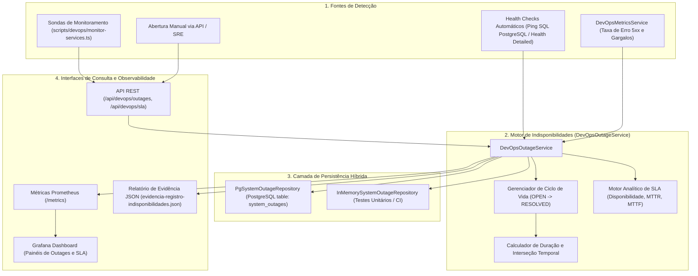

# PADRONIZAÇÃO DE DEVOPS: REGISTRO E ACOMPANHAMENTO DE INDISPONIBILIDADES

**Projeto:** Sistema de Estações Meteorológicas IoT — Cenário 01 (Agritech)  
**Instituição / Parceiro:** Fatec São José dos Campos / Tecsus — Tecnologias para a Sustentabilidade  
**Curso / Semestre:** 4º DSM — Semestre 2026-2  
**Frente:** Engenharia de DevOps, Observabilidade e Confiabilidade (SRE)  
**História de Usuário:** US06 — Disponibilidade e Escalabilidade do Sistema

---

## 1. OBJETIVO E ESCOPO

Este documento estabelece o padrão de engenharia, arquitetura de software, especificação de dados, procedimentos operacionais e métodos analíticos para o **registro, acompanhamento e histórico de períodos de indisponibilidade (downtime / outages)** da plataforma **AgriTech (Vulture)**, integrando essas informações diretamente à **validação formal do Acordo de Nível de Serviço (SLA $\ge 99.0\%$)**.

### 1.1. Escopo Atendido

1. **Identificação de ocorrências de indisponibilidade:** Mecanismo integrado aos ciclos de health check da aplicação, quedas do banco de dados relacional PostgreSQL e alertas de anomalias/latência.
2. **Registro de início e fim da ocorrência:** Ciclo de vida estruturado com carimbos precisos de data/hora (`startTime` e `endTime`), permitindo cálculo exato de duração em segundos.
3. **Registro de informações para análise da falha:** Armazenamento contextual de severidade, serviço afetado, mensagem de erro, stack técnica, código HTTP, hipótese de causa raiz e notas de resolução.
4. **Disponibilização do histórico:** Endpoints REST parametrizados (`GET /api/devops/outages`) e painéis analíticos para consulta pelo time de engenharia e sustentação.
5. **Utilização na validação do SLA:** Endpoint dedicado (`GET /api/devops/sla`) que confronta o tempo total de inatividade acumulado contra o período de observação e valida o cumprimento da meta de disponibilidade acordada.

### 1.2. Critérios de Aceite

| Critério de Aceite                                                           |     Status      | Implementação e Evidência                                                                                                                                                          |
| :--------------------------------------------------------------------------- | :-------------: | :--------------------------------------------------------------------------------------------------------------------------------------------------------------------------------- |
| **1. Indisponibilidades são registradas**                                    | ✅ **Atendido** | Entidade `SystemOutage` com persistência relacional na tabela `system_outages` (PostgreSQL) e em memória (`InMemorySystemOutageRepository`). Registro via API e hooks automáticos. |
| **2. Registros permitem identificar quando a falha ocorreu**                 | ✅ **Atendido** | Carimbos ISO 8601 de `startTime`, `endTime`, `durationSeconds` e `createdAt` preservados em cada registro.                                                                         |
| **3. Histórico fica disponível para consulta**                               | ✅ **Atendido** | Endpoint `GET /api/devops/outages` com suporte a filtros por `service`, `status` (`OPEN`/`RESOLVED`), intervalo temporal (`from`/`to`) e limite.                                   |
| **4. Dados podem ser utilizados no cálculo ou validação da disponibilidade** | ✅ **Atendido** | Endpoint `GET /api/devops/sla`, exportação de métricas OpenMetrics para Prometheus e painéis dedicados no Grafana.                                                                 |

---

## 2. ARQUITETURA DE REGISTRO E CICLO DE VIDA DE INDISPONIBILIDADES

A solução opera de maneira desacoplada e resiliente, integrando-se aos componentes de observabilidade do Fastify e do PostgreSQL:



---

## 3. MODELO DE DADOS E ESPECIFICAÇÃO DOS CAMPOS

### 3.1. Esquema Relacional no PostgreSQL (`system_outages`)

```sql
CREATE TABLE IF NOT EXISTS system_outages (
  id VARCHAR(64) PRIMARY KEY,
  service VARCHAR(100) NOT NULL,
  severity VARCHAR(20) NOT NULL,
  status VARCHAR(20) NOT NULL, -- 'OPEN' ou 'RESOLVED'
  start_time TIMESTAMPTZ NOT NULL,
  end_time TIMESTAMPTZ,
  duration_seconds NUMERIC(12, 2),
  reason TEXT NOT NULL,
  failure_details JSONB NOT NULL DEFAULT '{}'::jsonb,
  created_at TIMESTAMPTZ NOT NULL DEFAULT CURRENT_TIMESTAMP,
  updated_at TIMESTAMPTZ NOT NULL DEFAULT CURRENT_TIMESTAMP
);

CREATE INDEX IF NOT EXISTS idx_system_outages_service ON system_outages (service);
CREATE INDEX IF NOT EXISTS idx_system_outages_status ON system_outages (status);
CREATE INDEX IF NOT EXISTS idx_system_outages_start_time ON system_outages (start_time DESC);
```

### 3.2. Dicionário de Dados

| Campo             |      Tipo       | Obrigatório | Descrição                                                                   | Exemplo                                                     |
| :---------------- | :-------------: | :---------: | :-------------------------------------------------------------------------- | :---------------------------------------------------------- |
| `id`              |  `VARCHAR(64)`  |     Sim     | Identificador único e imutável do incidente                                 | `outage-1792584432682-67d91a4f`                             |
| `service`         | `VARCHAR(100)`  |     Sim     | Componente ou serviço afetado pela falha                                    | `postgresql`, `api-backend`, `iot-ingestion`                |
| `severity`        |  `VARCHAR(20)`  |     Sim     | Severidade do incidente: `CRITICAL`, `HIGH`, `WARNING`                      | `CRITICAL`                                                  |
| `status`          |  `VARCHAR(20)`  |     Sim     | Estado do ciclo de vida: `OPEN` (em andamento) ou `RESOLVED` (finalizado)   | `RESOLVED`                                                  |
| `startTime`       |  `TIMESTAMPTZ`  |     Sim     | Data e hora exata do início da indisponibilidade (UTC ISO 8601)             | `2026-10-21T04:00:00.000Z`                                  |
| `endTime`         |  `TIMESTAMPTZ`  |     Não     | Data e hora em que o serviço retornou à normalidade                         | `2026-10-21T04:08:20.000Z`                                  |
| `durationSeconds` | `NUMERIC(12,2)` |     Não     | Duração calculada da inoperância em segundos                                | `500.00` (8.33 minutos)                                     |
| `reason`          |     `TEXT`      |     Sim     | Resumo textual compreensível da falha                                       | `Esgotamento de conexões no pool do banco`                  |
| `failureDetails`  |     `JSONB`     |     Sim     | Metadados contextuais estruturados para diagnóstico pós-morte (Post-Mortem) | `{"error": "FATAL", "httpStatus": 503, "rootCause": "..."}` |
| `createdAt`       |  `TIMESTAMPTZ`  |     Sim     | Timestamp de criação do registro                                            | `2026-10-21T04:00:01.000Z`                                  |
| `updatedAt`       |  `TIMESTAMPTZ`  |     Sim     | Timestamp da última atualização                                             | `2026-10-21T04:08:20.000Z`                                  |

---

## 4. FORMULAÇÃO MATEMÁTICA E VALIDAÇÃO DE SLA

### 4.1. Taxa de Disponibilidade Real por Indisponibilidade

Dada uma janela temporal de observação $T_{\text{janela}}$ em segundos (ex.: 24 horas $= 86.400\text{ s}$ ou 30 dias $= 2.592.000\text{ s}$), e um conjunto de $n$ períodos de inatividade observados no intervalo:

$$\text{Downtime Total} = \sum_{i=1}^{n} \text{duração}(O_i \cap T_{\text{janela}})$$

$$\text{Uptime Total} = \max(0, T_{\text{janela}} - \text{Downtime Total})$$

$$\text{Disponibilidade (\%)} = \left(\frac{\text{Uptime Total}}{T_{\text{janela}}}\right) \times 100$$

### 4.2. Critério de Conformidade com o SLA

$$ \text{Status SLA} = \begin{cases}
\text{CONFORME (COMPLIANT)}, & \text{se Disponibilidade (\%)} \ge \text{Meta SLA (\%)} \\
\text{VIOLADO (BREACHED)}, & \text{se Disponibilidade (\%)} < \text{Meta SLA (\%)}
\end{cases}$$

$$\text{Margem (Gap) de SLA} = \text{Disponibilidade (\%)} - \text{Meta SLA (\%)} \quad (\text{onde } \text{Meta} = 99.00\%)$$

### 4.3. Métricas de Confiabilidade (MTTR e MTTF)

* **MTTR (Mean Time to Recovery):** Tempo médio despendido pela equipe até o restabelecimento do serviço:
$$\text{MTTR (minutos)} = \frac{1}{60 \cdot k} \sum_{j=1}^{k} \text{duração}(O_j)$$
*(onde $k$ é a quantidade de indisponibilidades resolvidas).*

* **MTTF (Mean Time to Failure):** Tempo médio contínuo de operação sem ocorrência de novas falhas:
$$\text{MTTF (horas)} = \frac{\text{Uptime Total (segundos)}}{3600 \cdot n}$$

---

## 5. ESPECIFICAÇÃO DAS ROTAS E APIS DISPONIBILIZADAS

Todas as rotas de DevOps são expostas com política de bypass de rate-limit e acesso de infraestrutura para ferramentas de observabilidade (Prometheus, Grafana, probes de health check).

### 5.1. `GET /api/devops/outages` — Consulta do Histórico de Indisponibilidades
* **Parâmetros de Query:**
  * `service` (string, opcional): filtra por serviço (ex.: `postgresql`, `api-backend`).
  * `status` (string, opcional): `OPEN` ou `RESOLVED`.
  * `from` (string ISO, opcional): início do intervalo de busca.
  * `to` (string ISO, opcional): término do intervalo de busca.
  * `limit` (número, padrão: 50): quantidade máxima de registros retornados.
* **Exemplo de Resposta HTTP 200:**
```json
[
  {
    "id": "outage-1792584432688-35efb705",
    "service": "api-backend",
    "severity": "HIGH",
    "status": "RESOLVED",
    "startTime": "2026-10-21T07:00:00.000Z",
    "endTime": "2026-10-21T07:03:00.000Z",
    "durationSeconds": 180,
    "reason": "Deploy de release e reciclagem de pods no cluster",
    "failureDetails": {
      "resolutionNotes": "Rolling update completado com sucesso e zero erros 5xx pós-aquecimento.",
      "detectionSource": "MANUAL"
    },
    "createdAt": "2026-10-21T12:07:12.688Z",
    "updatedAt": "2026-10-21T12:07:12.688Z"
  }
]
```

---

### 5.2. `GET /api/devops/outages/:id` — Consulta de Detalhes da Falha
* Retorna a entidade completa da indisponibilidade com todos os dados contextuais para análise forense (`failureDetails`).
* Retorna status `404 Not Found` caso o identificador não exista.

---

### 5.3. `POST /api/devops/outages` — Registro de Ocorrência de Indisponibilidade
* **Corpo da Requisição (JSON):**
```json
{
  "service": "postgresql",
  "severity": "CRITICAL",
  "reason": "Esgotamento de conexões no pool de dados",
  "startTime": "2026-10-21T04:00:00.000Z",
  "failureDetails": {
    "error": "FATAL: remaining connection slots are reserved",
    "httpStatus": 503,
    "impactedEndpoints": ["/api/readings", "/api/stations"]
  }
}
```
* **Resposta HTTP 201 Created:** Retorna o registro criado com status `OPEN`.

---

### 5.4. `PATCH /api/devops/outages/:id/resolve` — Encerramento de Indisponibilidade
* **Corpo da Requisição (JSON):**
```json
{
  "endTime": "2026-10-21T04:08:20.000Z",
  "resolutionNotes": "Executado expurgo de conexões ociosas e reiniciado pool.",
  "rootCause": "Timeout em transações longas sem fechamento no cliente legada."
}
```
* **Resposta HTTP 200 OK:** Retorna a ocorrência atualizada com status `RESOLVED`, `durationSeconds` preenchido e campos de auditoria consolidados.

---

### 5.5. `GET /api/devops/sla` — Validação Formal do SLA de Disponibilidade
* **Parâmetros de Query:**
  * `windowHours` (número, padrão: `720` - 30 dias).
  * `slaTargetPercentage` (número, padrão: `99.0`).
* **Exemplo de Resposta HTTP 200:**
```json
{
  "evaluationWindowHours": 24,
  "evaluationWindowSeconds": 86400,
  "totalTimeSeconds": 86400,
  "downtimeSeconds": 680,
  "uptimeSeconds": 85720,
  "availabilityPercentage": 99.213,
  "slaTargetPercentage": 99,
  "slaCompliant": true,
  "slaGapPercentage": 0.213,
  "outagesCount": 2,
  "activeOutagesCount": 0,
  "mttrMinutes": 5.67,
  "mttfHours": 11.91,
  "evaluatedFrom": "2026-10-20T12:00:00.000Z",
  "evaluatedTo": "2026-10-21T12:00:00.000Z"
}
```

---

## 6. MÉTRICAS EXPORTADAS PARA O PROMETHEUS (`/metrics`)

O endpoint `/metrics` exporta as novas métricas OpenMetrics para consumo contínuo pelo Prometheus:

```text
# HELP vulture_outages_total Total de ocorrencias de indisponibilidade registradas no historico.
# TYPE vulture_outages_total counter
vulture_outages_total 2

# HELP vulture_outages_active Quantidade de indisponibilidades ativas no momento (1 se houver indisponibilidade aberta, 0 caso contrario).
# TYPE vulture_outages_active gauge
vulture_outages_active 0

# HELP vulture_outage_downtime_seconds_total Tempo total acumulado de indisponibilidade em segundos.
# TYPE vulture_outage_downtime_seconds_total counter
vulture_outage_downtime_seconds_total 680

# HELP vulture_sla_availability_ratio_percentage Percentual de disponibilidade calculado para validacao do SLA com base em indisponibilidades.
# TYPE vulture_sla_availability_ratio_percentage gauge
vulture_sla_availability_ratio_percentage 99.213
```

---

## 7. PAINÉIS DE INDISPONIBILIDADE NO GRAFANA

O arquivo de configuração declarativa do painel Grafana (`monitoring/grafana/provisioning/dashboards/vulture-overview.json`) conta com 4 novos painéis na seção de confiabilidade:

1. **Indisponibilidades Ativas (Incidentes Abertos):** Painel do tipo *Stat*, indicando em tempo real se há falha em curso (verde $= 0$, vermelho $\ge 1$).
2. **Downtime Total Acumulado:** Painel do tipo *Stat*, demonstrando os segundos totais de indisponibilidade acumulados.
3. **Disponibilidade SLA Real (%):** Painel do tipo *Gauge*, confrontando a disponibilidade com a meta de $99.0\%$ (vermelho $< 98.5\%$, amarelo $98.5\% - 99.0\%$, verde $\ge 99.0\%$).
4. **Total de Indisponibilidades Registradas:** Contador histórico de todas as interrupções catalogadas.

---

## 8. PROCEDIMENTOS DE TESTE E AUTOMAÇÃO (CLI)

### 8.1. Execução dos Testes Automatizados de Unidade e Integração
Para validar a lógica de cálculo de SLA, o repositório de persistência e todas as rotas HTTP:

```bash
export PATH=/usr/local/lib/nodejs/node-v24.19.0-linux-x64/bin:$PATH
cd API-DSM-4-BACKEND
npm test -- src/modules/devops
```
* **Resultado:** 29 testes aprovados em 4 suites (`devops-metrics.service.test.ts`, `devops.route.test.ts`, `system-outage.service.test.ts`, `system-outage.route.test.ts`).

### 8.2. Execução da Simulação e Geração do Relatório de Evidência
Para executar a simulação ponta a ponta do ciclo de vida das indisponibilidades e gerar a evidência auditável:

```bash
export PATH=/usr/local/lib/nodejs/node-v24.19.0-linux-x64/bin:$PATH
cd API-DSM-4-BACKEND
npm run devops:outages
```

* **Arquivo de Evidência Gerado:** `docs/devops/evidencia-registro-indisponibilidades.json`

---

## 9. CONCLUSÃO

A implementação do **Mecanismo de Registro e Acompanhamento de Indisponibilidades** atende integralmente aos requisitos de confiabilidade da US06, garantindo à equipe técnica rastreabilidade completa sobre quando as falhas ocorrem, quanto tempo duram, quais serviços afetam, quais as causas raízes diagnosticadas e a comprovação matemática do cumprimento do SLA contratado ($\ge 99.0\%$).
$$
